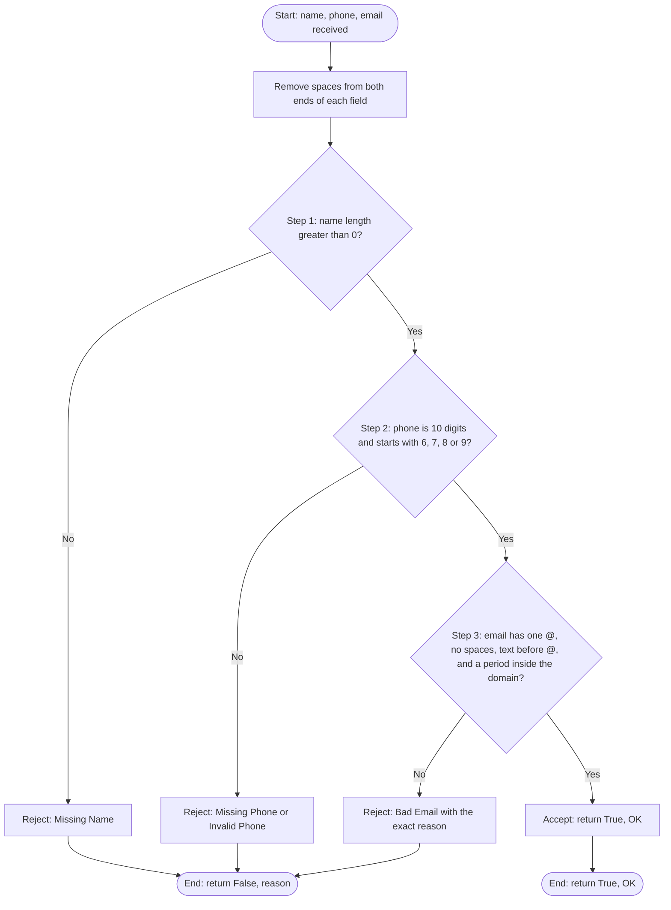
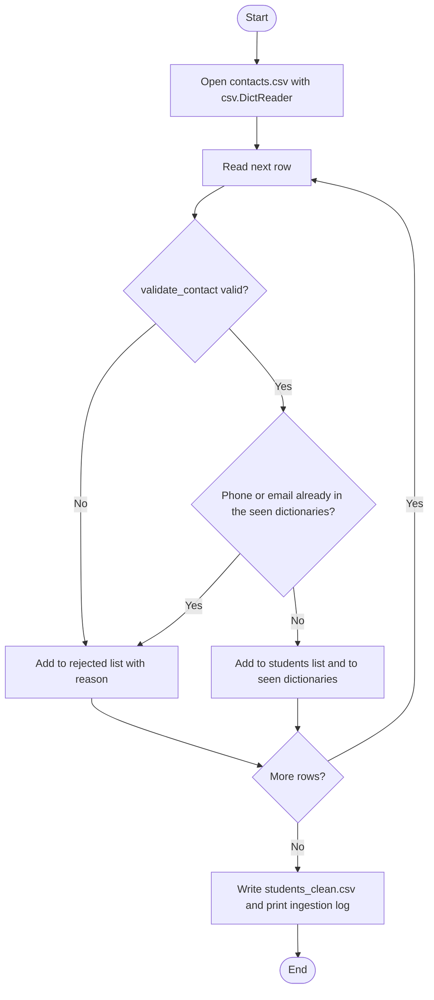
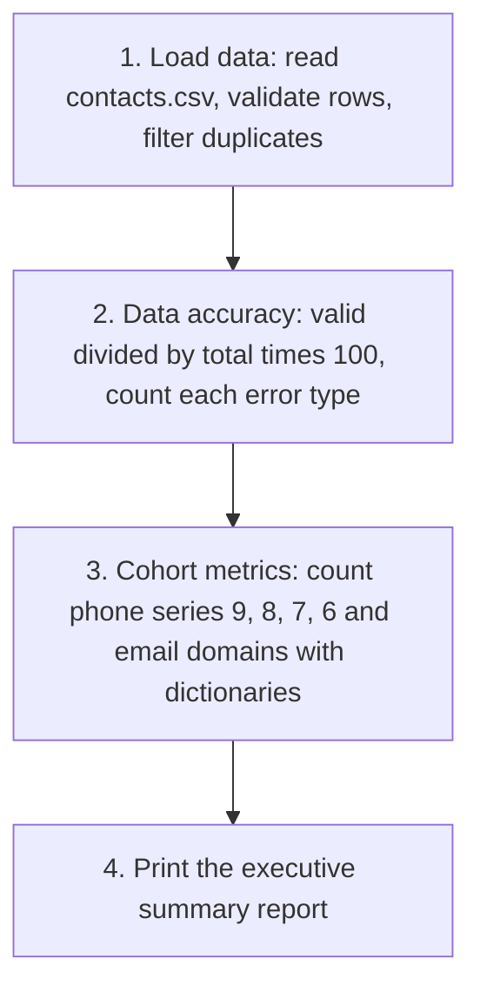

# Student Registration & Contact Intelligence System

Final Python Project (Section C), BCA Data Science, Semester 1

A pure Python program (no external libraries) that cleans a raw student registration
file, lets a coordinator manage the records from a menu, and prints a Business
Intelligence report.

---

## 1. Problem statement

A coaching institute collects student registrations in a spreadsheet file
(`contacts.csv`). The raw file has mistakes: missing names, wrong phone numbers,
badly written emails and the same student entered twice.

This project:
1. reads the CSV file and checks every row against strict rules,
2. rejects wrong and duplicate rows and writes the clean ones to `students_clean.csv`,
3. gives a menu to view, search, register, update and delete students,
4. prints a report on data quality, phone series and email domains.

## 2. Features

| Menu option | What it does |
|-------------|--------------|
| 1. View All Students | Table of all students with IDs |
| 2. Search Record | Find by phone number, email or name (a part of the name is enough) |
| 3. Register Student | Asks for details, validates, checks duplicates, then adds |
| 4. Update Student | Change name, phone or email of a student (found by ID or phone) with the same checks |
| 5. Delete Student | Delete by student ID or phone number, asks for confirmation |
| 6. Analytics Report | Business Intelligence summary |
| 7. Save and Exit | Saves everything to `students_clean.csv` |

Other things the program does:
- Wrong input never crashes the program. Every problem shows a clear reason.
- Duplicate phone numbers and duplicate emails are rejected. Emails are compared
  without caring about capital letters (`A@x.com` and `a@x.com` are the same).
- Student IDs are never reused after a delete.
- Data is loaded from `students_clean.csv` when the program starts, so changes are not lost.

## 3. Project structure

```
student_registration/
├── contacts.csv          raw input file (20 rows)
├── students_clean.csv    output: valid, non-duplicate students
├── validator.py          validation rules (Flowchart 1)
├── loader.py             reads the CSV, validates, removes duplicates, writes clean CSV
├── analytics.py          Business Intelligence report (Flowchart 2)
├── main.py               menu-driven console application
├── test_cases.py         49 test cases (prints PASS / FAIL)
├── proof/
│   ├── console_output.txt   saved run of loader, all 7 menu options and analytics
│   └── test_cases.txt       saved result of test_cases.py
└── README.md
```

| File | Main functions |
|------|----------------|
| `validator.py` | `validate_contact(name, phone, email)` returns `(is_valid, reason)`; `validate_name`, `validate_phone`, `validate_email`, `error_category` |
| `loader.py` | `load_contacts`, `find_duplicate`, `build_seen`, `save_students`, `load_students`, `print_ingestion_log` |
| `analytics.py` | `count_error_types`, `count_phone_series`, `count_email_domains`, `print_report` |
| `main.py` | `view_all`, `search_record`, `register_student`, `update_student`, `delete_student`, `main` |

## 4. How to run

Python 3.8 or newer is needed. No installation of libraries is required.

```
git clone https://github.com/<your-username>/student-registration.git
cd student-registration
```

| Command | What it does |
|---------|--------------|
| `python loader.py` | Reads `contacts.csv`, prints the ingestion log, creates `students_clean.csv` |
| `python main.py` | Opens the menu application |
| `python analytics.py` | Prints only the analytics report |
| `python test_cases.py` | Runs all test cases |

Start with `python loader.py`, then `python main.py`.
(On some computers the command is `python3` instead of `python`.)

To start again from the raw data, run `python loader.py`. It creates a fresh
`students_clean.csv` from `contacts.csv`.

## 5. Validation rules (`validator.py`)

The checks run in this order. The first one that fails gives the reason.

| Step | Field | Rule | Reason shown when it fails |
|------|-------|------|----------------------------|
| 1 | Name | Not blank, not only spaces | `Missing Name` |
| 2 | Phone | Not empty | `Missing Phone` |
| 2 | Phone | Digits only (`isdigit()`) | `Invalid Phone (digits only ...)` |
| 2 | Phone | Exactly 10 characters | `Invalid Phone (must be exactly 10 digits ...)` |
| 2 | Phone | Starts with 6, 7, 8 or 9 | `Invalid Phone (must start with 6, 7, 8 or 9)` |
| 3 | Email | Exactly one `@` | `Bad Email (no @ symbol)` / `(multiple @ symbols)` |
| 3 | Email | No spaces | `Bad Email (contains spaces)` |
| 3 | Email | Something before `@` | `Bad Email (nothing before @)` |
| 3 | Email | Something after `@` | `Bad Email (nothing after @)` |
| 3 | Email | Domain has a period that is not first or last | `Bad Email (domain needs a period ...)` |
| after | Phone / Email | Not already registered | `Duplicate Phone` / `Duplicate Email` |

Spaces at the start and end of every field are removed before checking.

### Flowchart 1: validation (`validator.py`)



### How a row is processed (`loader.py`)



## 6. Business Intelligence pipeline (`analytics.py`)

### Flowchart 2



The report has two parts:
- **Data quality** comes from the raw file `contacts.csv` (how clean the incoming data was).
- **Telecom and email domain tables** come from the students who are registered at that moment,
  so they change when students are added, updated or deleted in the menu.

Phone series is the first digit of the number. It only shows a pattern in the numbers.
It does not tell the mobile company, because customers can keep their number when they change company.

## 7. Data structures used

Each student is a dictionary, and all students are in a list:

```python
students = [
    {"id": 1, "name": "Aarav Sharma", "phone": "9876543210", "email": "aarav.sharma@gmail.com"},
    {"id": 2, "name": "Priya Patel",  "phone": "8123456789", "email": "priya_p@outlook.com"},
]
```

For duplicate checking, two dictionaries are used. The key is the phone or email
and the value is the name of the student who owns it:

```python
seen_phones = {"9876543210": "Aarav Sharma"}
seen_emails = {"aarav.sharma@gmail.com": "Aarav Sharma"}
```

Counting uses the frequency counter pattern:

```python
counts[domain] = counts.get(domain, 0) + 1
```

## 8. Results on the sample file

**Ingestion log** (`python loader.py`)

```
==============================================================
INGESTION LOG  (contacts.csv)
==============================================================
Total rows read      : 20
Valid rows accepted  : 12
Rejected rows        : 8

Reason for each rejected row:
  Row  4 | Ananya Sen       | Invalid Phone (must start with 6, 7, 8 or 9)
  Row  5 | Rahul Das        | Missing Phone
  Row  6 | Sneha Roy        | Duplicate Phone (already registered to Aarav Sharma)
  Row  7 | (blank)          | Missing Name
  Row  8 | Vikram Singh     | Bad Email (multiple @ symbols)
  Row 10 | Arjun Kapoor     | Bad Email (domain needs a period that is not first or last)
  Row 12 | Aditya Joshi     | Bad Email (contains spaces)
  Row 15 | Siddharth Rao    | Bad Email (nothing after @)

12 clean records saved to students_clean.csv
```

**Analytics report** (`python analytics.py`)

```
=======================================================
       STUDENT REGISTRATION - BUSINESS INTELLIGENCE
=======================================================
Total Contacts Processed : 20
Valid Registrations      : 12
Rejected Records         : 8
Data Quality Accuracy    : 60.0%

--- Data Entry Errors ---
  Bad Email      : 4
  Duplicate Phone: 1
  Invalid Phone  : 1
  Missing Name   : 1
  Missing Phone  : 1

Students Currently Registered : 12

--- Telecom Network Breakdown ---
  9-Series : 4 students (33.3%)
  8-Series : 4 students (33.3%)
  7-Series : 2 students (16.7%)
  6-Series : 2 students (16.7%)
  Largest segment: 8-Series

--- Top Email Domains ---
  @gmail.com        : 4 students
  @outlook.com      : 3 students
  @yahoo.com        : 2 students
  @domain.com       : 1 student
  @rediffmail.com   : 1 student
  @yahoo.co.in      : 1 student
=======================================================
```

The question paper shows a sample report with 13 valid records and 65%. That is only an
example of the layout. With the validation rules and the 20 rows of `contacts.csv`,
the correct result is **12 valid and 8 rejected (60.0%)**. This was also checked by hand:
rows 4, 5, 6, 7, 8, 10, 12 and 15 fail.

## 9. Sample terminal session

Part of a real run of `python main.py`. The full session with all options is in
`proof/console_output.txt`.

```
Enter your choice (1-7): 3

--- Register New Student ---
Name  : Rahul Das
Phone : 9000012345
Email : rahul.das@college.edu
Student registered successfully with ID 13.

Enter your choice (1-7): 3

--- Register New Student ---
Name  : Another Person
Phone : 9876543210
Email : another@gmail.com
Registration failed -> Duplicate Phone (already registered to Aarav Sharma)

Enter your choice (1-7): 4
Enter student ID or phone number to update: 3
...
Choice: 2
New phone: 5000000000
Update failed -> Invalid Phone (must start with 6, 7, 8 or 9)

Enter your choice (1-7): 5
Enter student ID or phone number to delete: 13
Delete Rahul Das (ID 13)? (y/n): y
Student deleted.
```

## 10. Testing

`python test_cases.py` runs **49 test cases**. The result is saved in `proof/test_cases.txt`.

| Area | What is tested |
|------|----------------|
| Normal values | Valid records, spaces around fields, subdomain emails |
| Name | Empty, only spaces, one letter (boundary) |
| Phone | Missing, starts with 5 and 0, letters, space inside, `+91`, 9 digits, 11 digits, `6000000000`, `9999999999`, `5999999999` (boundaries) |
| Email | Missing, no `@`, two `@`, space, nothing before or after `@`, no period, period first, period last, `a@b.c` (boundary) |
| Order of checks | Name error is reported before phone, phone before email |
| Duplicates | Same phone, same email, same email in capital letters, new record |
| Sample file | 20 rows read, 12 valid, 8 rejected, unique IDs, error counts, phone series counts, email domain counts |

Manual testing of the menu (all options, with correct and wrong input) is saved in
`proof/console_output.txt`.

## 11. Why I wrote it this way

- **Phone is a `str`, not an `int`.** A phone number is an identifier, not a number to calculate with.
  A string keeps leading zeroes and lets me use `isdigit()`, `len()` and `startswith` style checks.
- **`csv.DictReader` instead of `csv.reader`.** I can use `row["phone"]` with the column name.
  The code still works if the column order in the file changes.
- **Dictionaries for duplicates.** Checking `phone in seen_phones` is fast and does not need a loop
  over all students. The value also stores the owner's name, so the message can say who has the number.
- **Separate `validator.py`.** The same function is used by the loader (file rows), the Register option
  and the Update option, so the rules are written only once. It is also easy to test alone.
- **`validate_contact` returns `(is_valid, reason)`.** The caller gets the exact reason and can log it.
- **Error category in the reason text.** Every reason is `Category (detail)`, so
  `reason.split(" (")[0]` gives the category that analytics counts.

## 12. Limitations and future scope

- Data is stored in a CSV file. A database (SQLite) would be better for a big institute.
- The phone check is only for 10-digit Indian mobile numbers.
- The email check follows the given rules. It does not check if the email really exists.
- Search by phone and email needs the full value. Search by name accepts a part of the name.
- Future: export the rejected rows to a file, add more columns (course, city), a graph of the
  report with matplotlib, and a simple GUI.

## 13. Self-notes: what I learned and challenges

- **Strings:** `strip()`, `isdigit()`, `count("@")`, `split()` and slicing are enough to
  write all the validation rules without any special library.
- **Slicing for the domain rule:** "a period that is not the first or last character" became
  `"." in domain[1:-1]`, because the slice leaves out the first and last character.
- **Order of checks:** an empty phone also fails `isdigit()`. I check "empty" first so the
  message says `Missing Phone` and not a confusing digits message.
- **Logic building:** a row must pass the field rules first, and only then the duplicate rules.
  The first student keeps the phone number and later ones are rejected, so row 6 (Sneha Roy) is
  rejected and Aarav Sharma is kept.
- **Update bug to avoid:** while updating a student, the duplicate check must ignore that student's
  own record, otherwise every update looks like a duplicate of itself. I pass the student to skip.
- **Result check:** the report in the question paper shows 13 valid rows, but my program gave 12.
  I counted the 20 rows by hand and found 12 is correct, so I explained it in this README.
- **Capital letters:** `A@x.com` and `a@x.com` are the same email, so emails are saved in
  lowercase in the `seen_emails` dictionary.

## 14. Submission checklist

- [x] Public Git repository
- [x] Modular code: `validator.py`, `loader.py`, `analytics.py`, `main.py` (standard library only)
- [x] `contacts.csv` is read and processed by the loader
- [x] Business Intelligence report: data accuracy, telecom distribution, email domains
- [x] `proof/` folder with execution logs and test results
- [x] `README.md` with structure, run instructions and sample sessions
